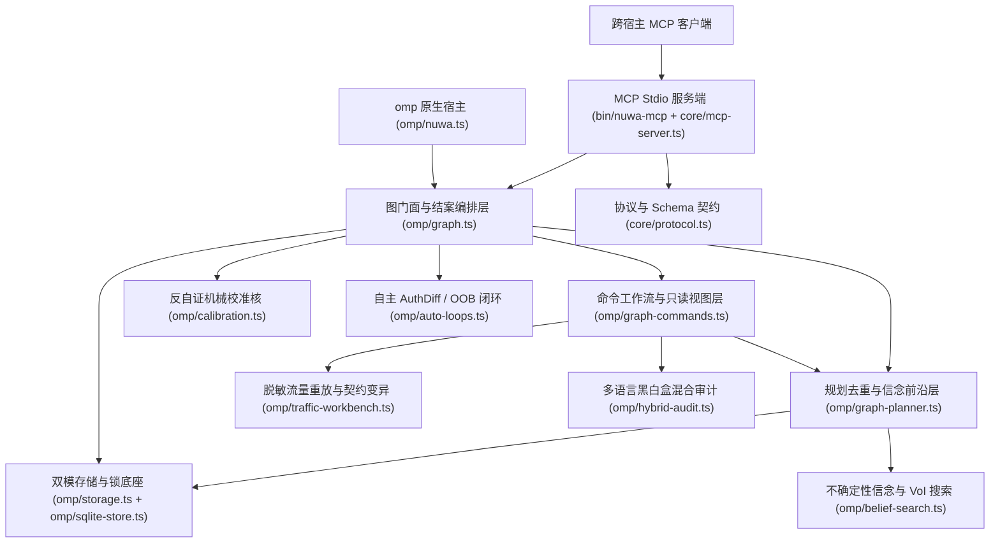

# 架构设计：女娲 v6.0.0 认知安全评估与跨宿主原生引擎

## 1. 架构总览

女娲 v6.0.0 采用 **宿主无关核心协议层（`core/`）+ 模块化无环 `omp` 原生运行时（30 个 TS 模块）+ 外层无头换血守护器（`bin/nuwa-autonomous`）** 的三层解耦架构：既能在 `omp` 会话内零开销原生运行，也能通过 `bin/nuwa-mcp`（JSON-RPC 2.0 over stdio）向 Claude Code、Cursor、Codex 等任意 MCP 宿主提供完全一致的 12 个 `nuwa_*` 工具、证据门禁与安全护栏。

### 硬性架构约束
1. **12 工具不变量**：严格保持 `nuwa_init`、`nuwa_plan`、`nuwa_frontier`、`nuwa_claim`、`nuwa_commit`、`nuwa_flag`、`nuwa_complete`、`nuwa_status`、`nuwa_report`、`nuwa_expand`、`nuwa_stop`、`nuwa_kb` 12 个核心工具名称 100% 不变。
2. **单向无环模块图（DAG）**：除总装入口 `omp/nuwa.ts` 外，其余所有 `omp/*.ts` 子模块严禁运行时 `import "./nuwa"`；`omp/graph.ts` 拆解为 `graph-planner.ts -> graph-commands.ts -> graph.ts` 单向依赖链，主文件严格控制在 `< 2,500` 行。
3. **零外部运行时依赖**：纯 Bun / Node.js 标准内置模块（`bun:sqlite`、`node:fs`、`node:crypto`、`node:http` 等），离线 `bun build` 100% 静态可编译。
4. **全链路零明文凭据泄露**：所有事实、SQLite 表、FTS5 索引、校准账本、流量记录、SARIF 报告与 PoC 证据包均强制脱敏。

---

## 2. v6.0 六大核心子系统

### 2.1 双模状态存储与 SQLite WAL 全文检索（`storage.ts` + `sqlite-store.ts`）
- 支持通过 `NUWA_STORAGE_BACKEND=json|sqlite|dual` 切换存储策略：
  - `json`（默认）：100% 兼容轻量文件锁与增量 `.json.gz` 快照，只读路径严格零磁盘写操作；
  - `sqlite` / `dual`：启用 `bun:sqlite` WAL 模式与 `busy_timeout`，初始化 10 张规范表（含 FTS5 虚拟表），支持 4 路并发写入无锁争用超时、`queryFactsByText` 中英文/路径/CVE 混合全文检索、坏库自动诊断回退或隔离重建，并同步维护 `state.json` 兼容视图。

### 2.2 贝叶斯信念图与预期信息增益（VoI）搜索（`belief-search.ts` + `graph-planner.ts`）
- 每个事实、意图与假设映射为共轭 Beta 分布节点 $(\alpha, \beta)$，实时计算后验均值 $\mu = \frac{\alpha}{\alpha+\beta}$、二元香农熵 $H(\mu)$ 与一步预期熵减（VoI）。
- `frontierList` 融合便携知识库历史胜率与 `rankFrontierByBelief`：当出现 `.js.map` 源码泄露、获取 `cred` 或双盲确认漏洞等 `breakthrough_signal` 时，瞬时拉升关联攻击链优先级；当双盲复验驳回（`verifier_reject`）或遭遇 WAF 硬拦截时，通过 `propagateBeliefUpdate` 与 `pruneLowYieldSubtree` 级联衰减并剪枝下游低收益分支。

### 2.3 反自证机械对账校准核与自适应模型路由（`calibration.ts` + `lineage.ts`）
- **反自证红线**：`validateSettlementSource` 机械拒绝 `self`、`model`、`agent` 等一切自评来源（抛出 `SELF_CERTIFICATION_FORBIDDEN`）；`verifyStage="candidate"` 暂存阶段严禁提前结算。
- **事前登记 → 机械结算**：`before_subagent_spawn` 基于信念后验向 `.nuwa/calibration.jsonl` 登记预测，仅在 `evaluatePositiveEvidenceGate` 拦截假阳性、双盲复验 `verify-vuln:<fid>` 裁决或 `exec-ledger` 实锤核验时由机械源单次结算。
- **自适应路由**：`routeSubagentModel` 在满足最小已结算样本门槛后联动 `recommendAdaptiveModelRoute`，基于 Brier Score、10-bin ECE、误报率与千 Token ROI 在 `allowedModels` 白名单内自动降权高误报模型。

### 2.4 自主 AuthDiff 与 OOB 评估闭环（`auto-loops.ts` + `graph.ts`）
- 批处理周期收尾自动调用 `runPostBatchAutonomousLoops`：满足多角色或新 `cred` 且未处冷却窗时自动执行只读多角色鉴权差分并将高置信越权存为 `candidate` 派发双盲复验；配置 `scope.oobDomains` 时自动为盲态高危面签发去重 Canary 并按 30s 节流轮询回收证据。

### 2.5 结构化流量工作台与黑白盒混合审计（`traffic-workbench.ts` + `hybrid-audit.ts`）
- `TrafficRecorder` 全自动擦除敏感头、Cookie、URL 查询/Fragment 令牌与正文密钥；`replayTrafficSequence` 支持跨步 Cookie Jar 与动态变量提取替换，跨 Origin `30x` 自动剥离认证头并强拦截越界重定向；`runStructuredMutations` 在并发 `<= 8` 硬约束下执行五类只读契约差分并过滤 Soft-404。
- `extractCodeAttackSurface` / `extractFromSourceMap` 多语言静态提取路由鉴权与四类危险汇点，经 `bridgeWhiteboxToBlackboxIntents` 生成合规只读黑盒核验意图，并由 `correlateBlackboxFindingToSource` 完成黑盒实锤到源码文件行号的双向闭环。

### 2.6 独立核心协议与跨宿主 MCP Server（`core/protocol.ts` + `core/mcp-server.ts` + `bin/nuwa-mcp`）
- `NuwaCoreEngine` 封装完整的状态机、证据核验、假阳性门禁与报告导出能力，不依赖任何特定宿主 UI；`bin/nuwa-mcp` 同时支持标准 `Content-Length` 头帧与换行分隔 JSON-RPC 2.0 帧，零污染 stdout 日志通道。
