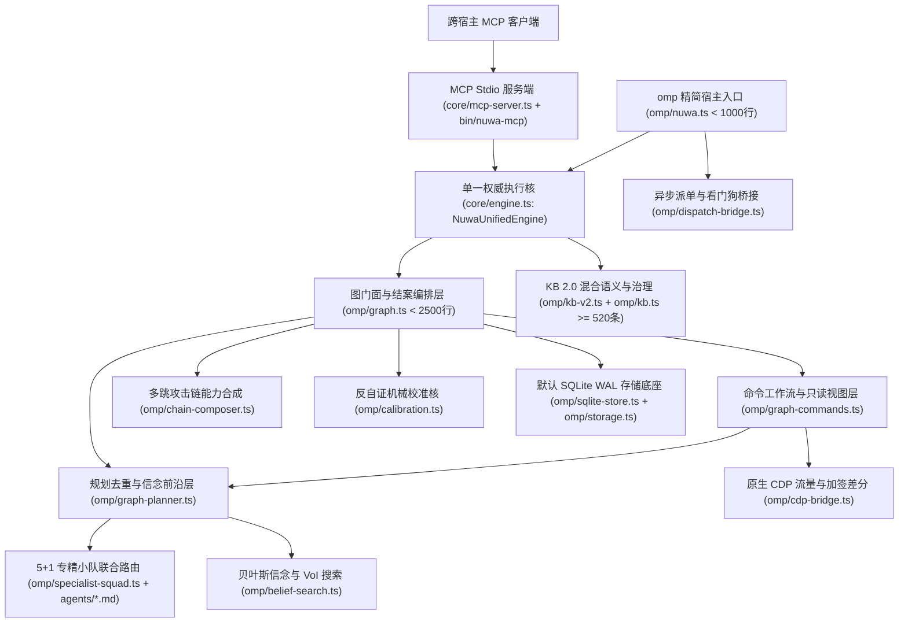

# 架构设计：女娲 v7.0.0 单核合一、专精小队与全栈认知安全引擎

## 1. 架构总览

女娲 v7.0.0 完成了从双端并行实现到 **宿主无关单一权威内核（`core/engine.ts`）** 的彻底收敛：`omp` 原生宿主入口（`omp/nuwa.ts`，`< 1,000` 行）与跨宿主标准 MCP 服务端（`core/mcp-server.ts` + `bin/nuwa-mcp`）100% 共享同一套状态机、12 个 `nuwa_*` 工具、28 个 `/nuwa` 斜杠命令与安全门禁；底层默认启用 **SQLite WAL 权威持久化**（同时严格守护遗留 JSON 项目只读零写盘），并在上层贯通 **5+1 专精特种小队**、**KB 2.0 混合语义与经验治理**、**原生 CDP 页面内借壳加签差分** 与 **2～4 跳能力互补攻击链合成引擎**。

### 硬性架构不变量
1. **单核合一与体积红线**：`omp/nuwa.ts` 严格 `< 1,000` 行、`omp/graph.ts` 严格 `< 2,500` 行；12 个 `nuwa_*` 核心工具名称、Schema 契约与 v4–v7 全部重导出符号 100% 向后兼容。
2. **单向无环模块图（DAG）**：除总装入口 `omp/nuwa.ts` 外，所有 `omp/*.ts` 与 `core/*.ts` 模块严禁运行时反向 `import "./nuwa"`；零第三方 npm 依赖，全仓通过严格 `tsc -p tsconfig.json --noEmit` 与离线 `bun build`。
3. **默认 SQLite WAL 与只读零写入**：`resolveStorageBackend` 默认返回 `"sqlite"`；写入时同步维护 `.nuwa/state.json` 兼容快照；在仅有 `.nuwa/state.json`（无 `nuwa.db`）的遗留目录执行任何只读查询/视图命令时，严格保证 **0 字节磁盘写入**（绝不自动创建 `nuwa.db`/`-wal`/`-shm`）。
4. **全链路零明文凭据泄露**：SQLite 10 张表、FTS5 索引、CDP 流量录制、攻击链跨跳一次性票据、校准账本、SARIF 与 PoC 证据包全链路强制脱敏。

---

## 2. v7.0 核心子系统详解

### 2.1 单核统一引擎与异步派单桥接（`core/engine.ts` + `omp/dispatch-bridge.ts`）
- `NuwaUnifiedEngine` 通过可选 `NuwaHostHooks` 解耦宿主差异（TUI 刷新、自动侦察批、Token 计量），内聚终态 `sealed_negative` / `completed` 防复活与防降级、多模式无默认值精准探测、假阳性门禁拦截与反自证机械结算。
- `DispatchBridgeStore` 消除模块级私有全局状态，精确对账 `omp 18.16.0` `details.async.state === "running"` 先返回 `progress[]` 后异步乱序触发 `before_subagent_spawn` 的时序，支持 4 MiB `taskFile` 与 `eval` 字符串词法安全占位符展开。

### 2.2 原生 CDP 流量桥接与页面借壳加签差分（`omp/cdp-bridge.ts`）
- 自动探测本机 Chrome/Chromium 并以 `Bun.spawn` + 原生 `WebSocket` 建立受控 CDP 会话，异常与退出时按进程组强制回收，确保零残留进程与临时目录。
- `captureCdpSessionTraffic` 在 `Fetch.requestPaused` 层强制执行 `checkScopeAndRisk`（越界请求直接 `Fetch.failRequest` 阻断，零外连泄露），实时脱敏落盘 `TrafficRecorder` 并提取认证态同步至 `SessionVault`。
- `executeInPageSignedProbe` 与 `runCdpSignedAuthDiff` 在同源页面上下文内借壳调用前端加签逻辑（强制锁定 `GET/HEAD/OPTIONS` 只读方法 + Soft-404/基线哈希去噪），免逆向穿透动态 HMAC/时间戳/Nonce 签名校验检出 BOLA/BFLA。

### 2.3 多跳攻击链能力合成与信念回灌（`omp/chain-composer.ts`）
- `extractFactCapabilities` 从活跃事实确定性抽取 `provides` 与 `requires` 能力标签及变量提取线索；`synthesizeAttackChains` 在 `2..4` 跳有界深度与防环约束下合成高优攻击链，融合信念后验与成本计算 `utilityScore`。
- `compileChainToTrafficSequence` 与 `executeAttackChainVerification` 基于 `replayTrafficSequence` 逐跳执行只读合规验证：全链打穿时生成待 `nuwa-verifier` 双盲复验的 `candidate` 复合漏洞并回灌 `breakthrough_signal`；中间第 `k` 跳受阻时返回精准 `brokenAtStep` 与 `brokenFactId` 回灌 `belief-search.ts` 衰减下游分支。

### 2.4 5+1 专精特种小队与 KB 2.0 混合语义治理（`omp/specialist-squad.ts` + `omp/kb-v2.ts`）
- **5+1 专精小队**：`nuwa-scout`（高速测绘）、`nuwa-spa-reverser`（前端与加签逆向）、`nuwa-auth-breaker`（多角色越权差分）、`nuwa-code-auditor`（黑白盒代码审计）、`nuwa-verifier`（独立双盲证伪）与通用 `fujiang`；`recommendSpecialistAndModel` 基于机械结算战绩执行角色×类别×模型联合路由。
- **KB 2.0**：自动融合 v4 种子与 `kb/seed-v7-pack.json`（`kb_items >= 520`）；`hybridKbSearch` 融合 FTS5 BM25、中英安全同义概念簇、TF-IDF 余弦、字符 2/3-gram Dice 与 64-bit SimHash；`governDistilledExperience` 仅采信授信机械核验源，对连续 `>= 5` 次零产出或高误报的蒸馏经验卡自动标记 `quarantined` 冻结，对高 ROI 经验卡晋升 `promoted`，并对内置种子卡实施硬性写保护。

### 2.5 L1 / L2 / L3 三层全覆盖评测靶场（`benchmarks/`）
- **L1（`run-eval.ts`）**：10 场景核心护栏与确定性能力微基准。
- **L2（`run-l2-eval.ts`）**：5 场景有状态全链路靶场与校准 Brier Score 硬门禁（`<= 0.25`）。
- **L3（`l3-live/run-l3-eval.ts`）**：3 场景真实操作系统进程树 + 原生 TCP `SOCKS5h` 隧道门禁（异步乱序派单经 SOCKS5h 实锤、硬化目标封盘零复活、`/tmp` 停止项目自动迁出续跑）。
